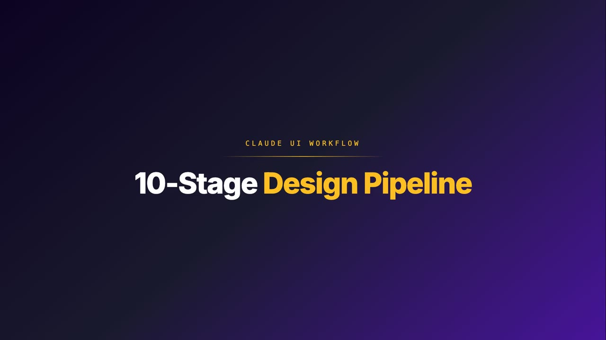
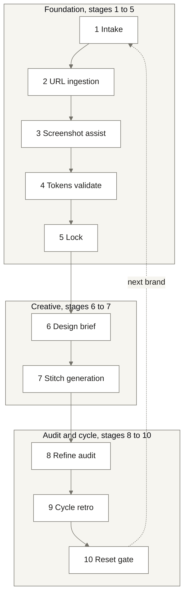
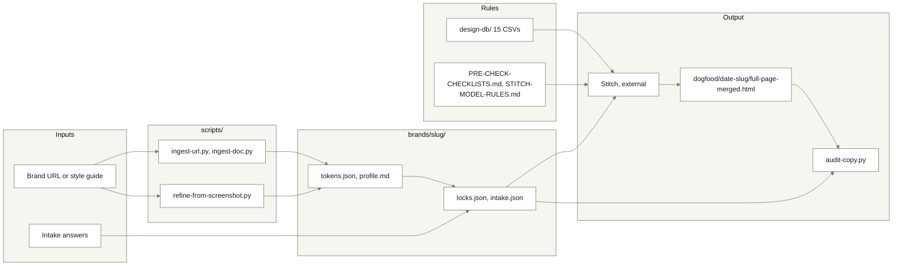

<picture>
  <source media="(prefers-color-scheme: dark)" srcset="assets/logo-dark.svg">
  <source media="(prefers-color-scheme: light)" srcset="assets/logo-light.svg">
  
</picture>

<br/>


**A 10-stage design pipeline that turns a brand brief into production-ready UI.**
**165+ rules across 15 design-system databases ensure the output never looks like AI made it.**

> [!NOTE]
> **TL;DR.** Drop a brand URL or a style guide in, answer a handful of questions, and the workflow writes the design brief, has Stitch paint the page, then audits every word of copy against your source before anything ships. Three real brands have been through it end to end; their live pages are linked below.

[](#see-it-in-action-live-samples)
[](#quick-start)
[](#companion-repos)

<!-- VIDEO -->
<a href="https://pipeline-proof.netlify.app/explainers.html"></a>

> **Walkthrough video:** 65-second tour of the 10-stage pipeline. ▶ [Watch on pipeline-proof](https://pipeline-proof.netlify.app/explainers.html). Full release: [v0.1-demo](https://github.com/sellersessions/claude-ui-workflow/releases/tag/v0.1-demo).
<!-- /VIDEO -->

> [!TIP]
> **New here?** The recipe lives in the per-stage checklists ([PRE-CHECK-CHECKLISTS.md](PRE-CHECK-CHECKLISTS.md)). If you only have time for one video, watch the **65-second walkthrough** above.

---

## Why this exists

You're an Amazon seller. You've got a product, a story, and a brand voice. What you don't have is six months of design school, a Figma certification, or a UX team on retainer. You want a landing page that looks like it cost £20K - without the £20K.

This is what happens when you pull this repo. Ten stages. You see the beautiful output. We do the alchemy underneath.

If you tried to run these ten steps yourself, you'd need to be a brand strategist, a colour theorist, a typographer, a copywriter, a prompt engineer, a UX auditor, and a project manager. You'd burn three weeks. The output would still look AI-generated. We hide all of it. You see a beautiful page. That's the trick - lead in, gold out, and you never have to know what went on in the crucible.

---

## What you can build

Sourced from real Amazon-seller use cases - full reasoning + footnoted references in [`Google Stitch-10 ideas for amazon sellers.md`](Google%20Stitch-10%20ideas%20for%20amazon%20sellers.md).

| # | Use case | Output |
|---|---|---|
| 1 | Brand storefront landing pages | HTML / CSS for Netlify or Webflow, drives external traffic to Amazon |
| 2 | Email newsletter templates | 600px-wide single-column HTML, retention + launch campaigns |
| 3 | Social media graphic templates | Reusable Instagram / Facebook story templates with brand tokens |
| 4 | Lead magnet / funnel pages | Discount-code capture, waitlists, early-access launches |
| 5 | Instagram / Facebook ad mockups | Rapid creative testing before paying for production design |
| 6 | Product comparison infographics | Side-by-side comparisons for A+ Content or social posts |
| 7 | Launch campaign countdown pages | Pre-order, Kickstarter-style hype pages with email capture |
| 8 | Video thumbnail templates | Consistent YouTube / TikTok thumbnails for product demos |
| 9 | Brand style guide documentation | One reference doc your VAs and agencies actually follow |
| 10 | Customer feedback / survey forms | Branded review collection with progress bars and incentives |

The same workflow also produces SaaS dashboards, mobile-app prototypes, multi-page user flows, dashboard admin interfaces, and design-system variations - anything where the inputs are a brand and a brief and the output is shippable UI.

---

## Claude UI Workflow vs a design agency / Stitch on its own

| Dimension | Design agency | Stitch on its own | Claude UI Workflow |
|---|---|---|---|
| **Source of truth** | The agency's Figma file | The last prompt you typed | `brands/<slug>/` tokens, locks and source-truth copy, in your repo |
| **Brand fidelity** | High, after rounds of feedback | Drifts between generations | Locked at Stage 5; no tool may overwrite a locked field |
| **Copy fidelity** | Proofread by a human, eventually | Rewrites your copy freely | Stage 8 hard-fail audit: every locked string present verbatim or the cycle cannot close |
| **Time to first page** | Weeks | Minutes, then hours of fixing | About an hour of your attention, most of it taste calls in Stitch |
| **Cost per page** | Four to five figures | Free tier | Free tooling; your time |
| **Who does the work** | Them, with you waiting | You, prompting blind | The workflow, with you signing off at the gates |
| **Learning between projects** | Stays with the agency | None | Stage 9 writes every finding into the checklists for the next run |
| **Runs on your machine** | No | No, browser only | Yes: scripts, rules and brand folders are local files |
| **Licence** | Their contract | Google's terms | MIT, see [Licence](#licence) |

---

## What it does



**Foundation 1 to 5** extracts brand DNA and locks the foundation. **Creative 6 to 7** writes the design brief and Stitch paints it. **Audit and cycle 8 to 10** refines, learns, and resets clean for the next brand.

### How the parts connect

Everything in the repo is either an input, a rule, a script, a skill or an output. The brand folder is the hub: scripts write into it, skills read from it, and the audit checks the rendered page against it.



<sub>Read left to right. A URL or a style guide becomes tokens and a profile; the intake interview and the `/lock` skill add the locked fields; those, plus the rule databases, feed the Stitch brief. The rendered page comes back and the audit script checks it against the same locks that went in. Nothing downstream can change what was locked upstream.</sub>

---

## How it works - the 10 stages

The full canonical reference (with autonomy classes and per-stage pre-checks) is in [`PRE-CHECK-CHECKLISTS.md`](PRE-CHECK-CHECKLISTS.md). The architecture is in [`DESIGN-PIPELINE-VISUAL.md`](DESIGN-PIPELINE-VISUAL.md). What follows is the plain-English version.

### Stage 1 - INTAKE

You answer a handful of questions. Not fifty - just enough for the system to know who the page is for, what the offer is, what the vibe should feel like. We're not interviewing you for a textbook. We're listening for the signal that lets the next nine stages run on rails.

### Stage 2 - URL ingestion (extract-brand)

Got an existing site, or a competitor you admire? Drop the URL. We pull the brand DNA out - colours, fonts, hierarchy, voice - without you needing to know what a hex code is or what "type scale" means. The whole brand identity becomes structured data we can act on. You don't open Photoshop. You don't pick fonts. You drop a link.

### Stage 3 - Screenshot assist (low-confidence rescue)

Sometimes URL extraction misses things - cream-on-cream hero bands, dark themes hidden behind cookie banners, subtle gradients. When confidence is low, we capture the page visually and read it the way a designer's eye would. You don't have to know it happened. You just notice the output is right.

### Stage 4 - Tokens validate

Every colour, font, and spacing rule gets locked into a single source of truth. This is the bit design agencies charge five figures for and call a "design system." You get it free, and you get it in 30 seconds. From here on, nothing in the build can drift outside those rails.

### Stage 5 - Lock primitive

You eyeball the foundation and sign it off. Once locked, no AI tool is allowed to overwrite it. This is the rule that stops the model going off-script halfway through and inventing a new colour palette out of thin air. Your brand stays your brand for the rest of the workflow.

### Stage 6 - Design brief assembly

Here's the part no Amazon seller has ever had to do - and now never will. The system writes the design brief itself, in the exact language the design model needs, pulling everything we locked from Stages 1 to 5. You don't write prompts. You don't learn prompt engineering. You collect the output.

### Stage 7 - Stitch generation

Google's Stitch model paints the page. We've already learned which model variant to use for which job - 3.1 Pro for copy-faithful work, never 3 Flash for multi-section pages, Refresh mode for canonical brands. Those rules are baked in (full set in [`STITCH-MODEL-RULES.md`](STITCH-MODEL-RULES.md)). You don't pick. You don't gamble. You don't lose a Saturday afternoon to "why does it look broken now."

### Stage 8 - REFINE pass

Now the audit. Every word in the rendered page gets cross-checked against your truth-source copy. Every layout block gets eyeballed against the design brief. Drift gets caught, hallucinations get killed, and the page that lands is the page you actually approved. This is the step a junior designer would skip and a senior designer would charge a day's billing for.

### Stage 9 - Cycle retro

Every problem we hit gets logged, classified, and either fixed before the next round or codified as a permanent rule. The system literally gets sharper every time you use it. The version of this workflow you run next month is better than the one you run today - without you having to lift a finger.

### Stage 10 - Cycle reset gate

Clean handoff. Nothing from the last brand leaks into the next one. Your supplements brand doesn't accidentally inherit your fashion brand's palette. Boring on the surface, ruthless underneath - and the reason you can run this on five products in a row without the work degrading.

---

## Set-up SOP

For a seller, a VA or anyone who has never installed a developer tool. Seven steps, about 30 minutes, most of it waiting for downloads. If you have done this before, skip to [Quick Start](#quick-start).

Two things worth knowing before you start:

- **Nothing here costs money.** Claude Code needs an Anthropic account. Stitch needs a free Google account. Netlify's free tier is enough for publishing. The scripts are free and run on your own machine.
- **Nothing here is hard to undo.** Everything the workflow writes lands inside one folder. Step 7 says how to remove it.

### Step 1. Install Claude Code

Follow the install page at [claude.com/product/claude-code](https://claude.com/product/claude-code) for your Mac or PC. Claude Code is the assistant that runs the stages for you, so this is the one tool you cannot skip.

Success looks like: open a terminal, type `claude --version`, and a version number prints.

### Step 2. Get the folder

```bash
git clone https://github.com/sellersessions/claude-ui-workflow.git
cd claude-ui-workflow
```

This copies the workflow to your machine and steps into it. Every later command runs from inside this folder.

Success looks like: `ls` lists `PRD.md`, `RUNBOOK.md` and a `brands` folder.

### Step 3. Install the Python tools

```bash
python3 -m venv .venv
.venv/bin/pip install -r requirements.txt
```

The first line makes a private box for the Python packages so they do not touch anything else on your machine. The second installs the two image libraries the screenshot-assist stage uses.

Success looks like: the last line printed starts with `Successfully installed`, or `Requirement already satisfied` if you have run it before.

### Step 4. Install the browser tools

```bash
npm install
```

This installs Playwright and a copy of Chromium that the URL-ingestion script drives. The download is a few hundred megabytes; let it finish.

Success looks like: the command ends with no line containing `ERR!`.

### Step 5. Optional: the full extraction cascade

```bash
cd ..
git clone https://github.com/sellersessions/extract-flow.git
cd claude-ui-workflow
```

`extract-flow` is a sister project that reads stubborn sites (cookie walls, bot checks). Without it, Stage 2 still runs on plain fetching, with lower confidence on hard sites. Clone it next to this folder, not inside it.

Success looks like: `ls ..` shows `claude-ui-workflow` and `extract-flow` side by side.

### Step 6. Sign in to Stitch

Stage 7 is done by hand in [Stitch](https://stitch.withgoogle.com), Google Labs' design model, in your browser. Sign in with a free Google account once so it is ready when the brief arrives. Which Stitch model to pick for which job is already decided for you in [`STITCH-MODEL-RULES.md`](STITCH-MODEL-RULES.md).

Success looks like: Stitch opens to an empty canvas with your account in the corner.

### Step 7. Run the first stage, and how to go back

Open Claude Code inside the folder and type:

```text
/intake
```

It asks you the Stage 1 questions one at a time and writes the answers to `brands/<your-slug>/intake.json`.

Success looks like: a new folder under `brands/` named after your brand, holding `intake.json`.

Going back: delete the `claude-ui-workflow` folder. The only things installed outside it are Claude Code and the Chromium copy under Playwright's own cache, both of which can stay or be uninstalled through their normal routes.

<details>
<summary><b>Caveats</b>: the three places a first run usually stalls</summary>

<br/>

- **Stage 3 (screenshot assist)** wants a full-page screenshot. Any screenshot tool works; the script takes a file path.
- **Stage 7 (Stitch)** is manual: you paste the brief in, iterate, export. There is no button in this repo that runs it.
- **Memory layer.** Some notes mention a memory layer and session-close hooks. Those belong to the operator's own set-up. The workflow runs without them.

</details>

---

## What you need to run this

Honest dependency surface - what comes in this repo, what a stranger brings.

| Dependency | In the repo? | What you bring |
|---|---|---|
| `scripts/audit-copy.py`, `emit-tokens.py`, `ingest-url.py`, `ingest-doc.py`, `refine-from-screenshot.py`, `ref-image-check.py` | Yes, in `scripts/` | Python 3.10+ and `pip install -r requirements.txt` |
| `extract-flow` (4-tier extraction cascade: HTTP, headless, CDP, SeleniumBase) | No, sibling repo | Clone [`sellersessions/extract-flow`](https://github.com/sellersessions/extract-flow) next to this one. Without it, Stage 2 falls back to plain `WebFetch`. |
| Claude Code (CLI) and the `/intake`, `/lock`, `/refine` skills | No, external | Install Claude Code. `/intake` and `/lock` ship under `.claude/skills/` in this repo. `/refine` runs from the operator's own skill set and is described in [`RUNBOOK.md`](RUNBOOK.md). |
| Stitch (Google Labs) | No, external | Free Google account. Stage 7 is a manual paste-and-iterate in the Stitch web UI. |
| Netlify (deploy target) | No, external | Free tier works. One of many possible static targets: Vercel, Cloudflare Pages, GitHub Pages, plain S3 all fine. |
| Computer-use MCP (Stage 8 visual validation) | No, external | Optional. Falls back to headless Chrome `--screenshot` if absent. |
| Memory layer (ChromaDB / similar) | No, external | Optional. Used by the operator's session-close hooks. The workflow itself doesn't require it. |

**Plain English:** if you have Claude Code and Python, stages 1, 2, 4, 5, 6, 8, 9, 10 run today. Stage 3 (screenshot rescue) needs computer-use MCP or you do it manually. Stage 7 (Stitch) is a manual paste-and-iterate. Cloning `extract-flow` alongside this gives Stage 2 the full cascade; without it, Stage 2 falls back to plain `WebFetch`.

---

## Quick Start

```bash
git clone https://github.com/sellersessions/claude-ui-workflow.git
cd claude-ui-workflow
npm install && python3 -m venv .venv && .venv/bin/pip install -r requirements.txt
python3 scripts/ingest-url.py https://example.com --slug example-derived
```

There is no `npm run pipeline`: the repo is a workflow surface, not a single executable. The last line above writes `brands/example-derived/{tokens.json, profile.md, ingestion-confidence.md}`; the confidence file flags low- and medium-confidence palette roles. From there, open Claude Code in the folder and run `/intake`, then `/lock`.

<details>
<summary><b>Two more ingestion routes</b>: screenshot rescue and style-guide documents</summary>

<br/>

When extraction confidence is weak, refine with a full-page screenshot:

```bash
.venv/bin/python3 scripts/refine-from-screenshot.py \
    --slug example-derived \
    --screenshot ~/Screenshots/example-2026-04-25.png
```

Samples nav, hero, and body bands; proposes overrides for `secondary`, `cta`, `text_secondary`; rewrites `tokens.json` and appends a `## Screenshot Overrides` section to the confidence doc. Use `--no-prompt` for dry-run, `--show-palettes` to inspect per-region quantised palettes.

Got a written style guide instead of a site?

```bash
python3 scripts/ingest-doc.py path/to/brand-guide.md --slug example-derived
```

Two-pass parser: strict pass for canonical-shape docs (`## Identity`, `## Theme`, `## Colours`, `## Typography`), fuzzy fallback for free-form guides (line-context hex + role keywords). Markdown / plain text only - convert PDF / docx / Notion exports first.

</details>

---

## Test protocol

Run once, before you trust the workflow with a real brand. About ten minutes. Everything it needs is already in the repo: the Push-Pull Agency sample under `dogfood/2026-04-27-pushpullagency/` carries its source copy, its locks and the page that passed.

| # | Check | How | Pass looks like |
|---|---|---|---|
| 1 | The scripts load without missing dependencies | `python3 scripts/audit-copy.py --help` | A usage block prints, starting `usage: audit-copy.py`. No traceback. |
| 2 | Ingestion writes a brand folder | `python3 scripts/ingest-url.py https://example.com --slug example-derived` | `brands/example-derived/` exists and holds `tokens.json`, `profile.md`, `ingestion-confidence.md` |
| 3 | The audit catches drift (the negative case) | Copy `source-truth.json`, `locks.json` and `full-page-merged.html` from the sample to a scratch folder. In the HTML, change `17x revenue growth in just two years` to `17x revenue growth in two years`. Run `python3 <repo>/scripts/audit-copy.py` in that folder | A `MISSING` block names the string (`FAIL stats_verbatim[0]`), then a final line starting `FAIL` that says the cycle cannot lock |

**Step 4. Give it a real job.**

```bash
cd dogfood/2026-04-27-pushpullagency
python3 ../../scripts/audit-copy.py
```

Grade it on these, not on whether it felt right:

- **Pass.** `45/45 strings present verbatim`, `15/15 phrases absent`, and a final line starting `PASS`. The gate works and the shipped sample is intact.
- **Partial.** The usage block printed in check 1 but the real job reports a missing string. The sample on your disk has been edited; re-clone and run again before blaming the audit.
- **Fail.** A Python traceback, or `PASS` on the deliberately broken copy in check 3. Stop. The audit is not protecting you. Open an issue with the full output before running a brand through.

---

## See it in action: live samples

Three real brands run through the full 10-stage workflow. All passed the Stage 8 hard-fail audit (every locked string from the brand's source-truth verbatim in the rendered DOM, every anti-drift string absent). Click any link to compare.

| Brand | Original site | Workflow output | REFINE score | Notes |
|---|---|---|---|---|
| Re Tech UK | [retechuk.com](https://retechuk.com) | [retechuk-cycle3.netlify.app](https://retechuk-cycle3.netlify.app) | 27/30 | Editorial fashion. 0 patches needed - model gate routed to Stitch 3.1 Pro for copy fidelity, shipped clean on first audit. |
| Databrill Core | [core.databrill.com](https://core.databrill.com) | [databrill-core-cycle3.netlify.app](https://databrill-core-cycle3.netlify.app) | 27/30 | Dark-palette SaaS. 1 patch - Stage 8 hard-fail caught 4 missing `<h3>` titles in problem-grid that visual review missed. |
| Push-Pull Agency | [pushpullagency.com](https://pushpullagency.com) | [pushpullagency-cycle4.netlify.app](https://pushpullagency-cycle4.netlify.app) | 28/30 | Full-service Amazon agency. 1 refine pass - restored Stitch design language (massive 2-line hero, left icon rail, cobalt parallelogram clip-shapes, accent cards) while keeping all 45 locked strings verbatim. |

All three deliverables started from a real URL, then extract-flow ingestion, then `source-truth.json` + `locks.json`, then the Stitch visual brief, then Claude-written HTML merged with locked copy, then the 6-dimension REFINE audit, then the cycle reset gate.

**A few things to know about these comparisons:**

- **Not a 1:1 image clone.** This is a design system being applied to your page - colour, typography, layout, component behaviour, motion language. The placeholder visuals in our samples come from Stitch's renderer; on your live site you'd swap in your own product photography, brand assets, and team shots. The system carries the *design language*, not the source brand's images.
- **First-pass output.** What you see is the output of a single pass through the workflow. You can iterate as many times as you want, but the entire point of the system is to land an excellent first pass - design and aesthetic are subjective, and we don't have time for endless revisions. The goal is a strong, on-brand starting point that holds up to scrutiny on day one.

### How fast is it?

The speed comes from rules getting written down. Each cycle codifies what was tribal into `PRE-CHECK-CHECKLISTS.md`, `STITCH-MODEL-RULES.md`, and the audit script - so the next cycle takes less attention.

- **Cycle 1 (Re Tech UK).** 29 findings logged. Every stage operator-supervised. The pipeline shape was right; the codification work was the gap.
- **Cycle 2 (Databrill Core).** 8 new findings. The v2 architecture shipped: `PRE-CHECK-CHECKLISTS.md` + `STITCH-MODEL-RULES.md` + the cycle-2 fix wave. `audit-copy.py` debuted as a programmatic Stage 8 gate. The visual-brief merge primitive (Stitch design DNA × locked source-truth copy) proved out.
- **Cycle 3 (Databrill Core, Stage 8 hard-fail).** 3 findings. The hard-fail copy audit caught 4/88 silently-dropped headings that visual review missed. Stage 8 promoted from check to blocking gate.
- **Cycle 4 (Push-Pull Agency).** Stages 1-6 ran in about 8 minutes autonomously. The first real operator interaction was Stage 7 (Stitch). Stage 8 audit was a one-shot pass - 45/45 locked strings present, 0 anti-drift hits. Total active operator time about 50 minutes, mostly design taste calls in Stitch. Locked at 28/30.

Each cycle's rules trust themselves a little more, so the operator's review collapses toward taste calls only.

---

## Brand profiles

Brand profiles drive every stage. One folder per brand, one canonical `profile.md`, with `tokens.json`, `locks.json` and `intake.json` added as the stages run. Five brand folders ship in this repo; the Seller Sessions profile seen in the walkthrough video is held privately and is not in the public folder.

| Folder | What it is | Stages reached |
|---|---|---|
| `brands/retechuk/` | Re Tech UK, editorial fashion. Cycle 1, then cycle 3 | Full set: profile, tokens, locks, intake, confidence |
| `brands/databrill-core/` | Databrill Core, dark-palette SaaS. Cycles 2 and 3 | Profile, tokens, cycle-2 lock note, moodboard and logo concept assets |
| `brands/databrill-core-extracted/` | The same brand, as the extraction cascade read it, kept for comparison | Tokens and confidence |
| `brands/databrill/` | The parent Databrill brand | Profile and tokens |
| `brands/claude-ui-workflow/` | This repo's own brand, used for the local UI mockup | Profile and tokens |
| `brands/_template/` | Copy this when adding a new brand | Profile and tokens templates |

```
brands/
├─ _template/profile.md          copy this when adding a new brand
├─ INVENTORY.md                  status per brand
├─ TOKENS-SCHEMA.md, LOCKS-SCHEMA.md, INTAKE-SCHEMA.md, REF-IMAGE-REPORT-SCHEMA.md
├─ retechuk/
│  ├─ profile.md
│  ├─ tokens.json
│  ├─ locks.json
│  └─ intake.json
└─ <your-brand>/                 yours goes here
```

New brands copy `brands/_template/profile.md` - every section including performance budgets and animation preferences. Status per brand lives in [`brands/INVENTORY.md`](brands/INVENTORY.md). The four schema files beside it define what each JSON must contain.

---

## Architecture / folder map

One block per part of the repo. Open the one you need.

<details>
<summary><b>The documents at the root</b>: where the goal, the runbook and the rules live</summary>

<br/>

**WHY.** A workflow with ten stages needs one place that says what it is for, one that says what runs today, and one that says how each stage is checked. Without them every session re-derives the same answers.

**WHAT.** [`ROUTING-AND-INDEX.md`](ROUTING-AND-INDEX.md) says which folder holds which work and which files each task reads; `CLAUDE.md` is a three-line pointer to it. [`PRD.md`](PRD.md) is the north star. [`RUNBOOK.md`](RUNBOOK.md) says what works today and what is queued. [`PRE-CHECK-CHECKLISTS.md`](PRE-CHECK-CHECKLISTS.md) is the 10-stage canonical with per-stage pre-checks. [`STITCH-MODEL-RULES.md`](STITCH-MODEL-RULES.md) chooses the Stitch model for Stage 7. [`DESIGN-PIPELINE-VISUAL.md`](DESIGN-PIPELINE-VISUAL.md) is the architecture deep-dive with the 15 CSV catalogue. [`MASTER-LOG.md`](MASTER-LOG.md) is the session-by-session timeline with the kickoff prompt at the top. [`OUTSTANDING-WORK.md`](OUTSTANDING-WORK.md) is the rolling work list. [`STAGE-CMD.md`](STAGE-CMD.md) is the on-stage cue card from the May 2026 event. [`Design System Workflow Ideas.md`](Design%20System%20Workflow%20Ideas.md) and [`Google Stitch-10 ideas for amazon sellers.md`](Google%20Stitch-10%20ideas%20for%20amazon%20sellers.md) are the two idea notes the workflow grew out of.

**HOW.** Read in this order: the routing index, PRD, RUNBOOK, then the checklist for the stage you are on.

**WHAT IF.** If RUNBOOK and PRD disagree, PRD wins. The MASTER-LOG is long; read the kickoff prompt and the latest session only.

</details>

<details>
<summary><b>brands/ and design-db/</b>: the inputs and the rules</summary>

<br/>

**WHY.** The brand folder is the single source of truth the stages read and write, and the rule databases are what stop the output looking machine-made.

**WHAT.** `brands/` holds one folder per brand (see Brand profiles above) plus four schema files, an inventory and its own [`ROUTING-AND-INDEX.md`](brands/ROUTING-AND-INDEX.md). `design-db/` holds the 15 CSV databases: colours, typography, page structure, anti-patterns, animation timing, accessibility, cognitive science, performance budgets and more, 165+ rules in all. Four quality gates sit on top of the rules: design-token extraction, web-design guidelines, React performance, composition patterns. The Stage 8 REFINE audit scores six dimensions: refinements, animation, polish, performance, anti-AI, HCI laws. The stages call on five MCP servers where present: Stitch, 21st.dev Magic, NanoBanana2, Video Transcriber, Sequential Thinking. The full per-stage tool map is in [`DESIGN-PIPELINE-VISUAL.md`](DESIGN-PIPELINE-VISUAL.md).

**HOW.**

```bash
cp -r brands/_template brands/<your-slug>
```

**WHAT IF.** A rule you disagree with lives in one CSV row. Change the row, not the prompt.

</details>

<details>
<summary><b>scripts/ and .claude/skills/</b>: the automation</summary>

<br/>

**WHY.** Stages 2, 3, 4 and 8 are mechanical. Scripts make them repeatable; skills make them callable from inside Claude Code.

**WHAT.** Eight scripts, indexed in [`scripts/ROUTING-AND-INDEX.md`](scripts/ROUTING-AND-INDEX.md): `ingest-url.py`, `ingest-doc.py`, `refine-from-screenshot.py`, `extract-brand.mjs`, `emit-tokens.py`, `compare-tokens.py`, `ref-image-check.py`, `audit-copy.py`. Two skills shipped with the repo: `/intake` (Stage 1 interview) and `/lock` (Stage 5 lock primitive). `package.json` maps six of the eight to `npm run` names; `audit-copy.py` and `ref-image-check.py` are run directly.

**HOW.**

```bash
npm run ingest-url -- https://example.com --slug example-derived
```

**WHAT IF.** `audit-copy.py` has no dependencies beyond the standard library, so it runs on a bare Python install. The others need the venv from the Set-up SOP.

</details>

<details>
<summary><b>dogfood/, deploy/ and examples/</b>: the evidence</summary>

<br/>

**WHY.** A workflow that claims to produce good output has to show its runs, including the friction.

**WHAT.** `dogfood/` holds three dated cycle runs, indexed in [`dogfood/ROUTING-AND-INDEX.md`](dogfood/ROUTING-AND-INDEX.md) (Re Tech UK 25 Apr, Databrill Core 26 Apr, Push-Pull Agency 27 Apr 2026), each with its source-truth, locks, merged page and retro (the first two runs keep a friction log, the third a time log). `deploy/` holds the three Netlify deliverables. `examples/stitch/` holds two Stitch reference exports (a fintech demo and a waitlist mockup) for anyone judging raw Stitch output quality.

**HOW.** Start with `dogfood/2026-04-27-pushpullagency/cycle-4-retro.md`, the most recent retro.

**WHAT IF.** Any `_captures/` folder inside a run holds browser screenshots and is ignored by git. A fresh clone has the documents, not the pictures.

</details>

<details>
<summary><b>design-system-sections/, records/, reference/ and _ui-mockup/</b>: the thinking</summary>

<br/>

**WHY.** Decisions made once should not be re-argued. These folders hold the reasoning.

**WHAT.** `design-system-sections/` holds eight design notes and decision records (Stitch integration, logo prompts, Claude skills for designers, moodboards). `records/` holds two inspiration transcripts captured in March 2026. `reference/` holds three source notes on Stitch and Claude Design capabilities. `_ui-mockup/` is a six-page local HTML mockup of a passive heads-up display for the workflow (May 2026), opened straight from disk.

**HOW.** Open `_ui-mockup/index.html` in a browser.

**WHAT IF.** These are reference folders. Nothing in the stages reads them.

</details>

<details>
<summary><b>_captures/ and _archive/</b>: local only, never pushed</summary>

<br/>

**WHY.** Screenshots and retired files are useful on the operator's machine and noise in a public repo.

**WHAT.** `_captures/` holds ten sets of browser captures from the build and the SSL 2027 Loom walkthrough. `_archive/` holds files retired from the root and the previous README. Both are in `.gitignore`, so they exist only on the operator's machine.

**HOW.** Nothing to run. They exist only on a machine that made them.

**WHAT IF.** A fresh clone has neither folder. That is expected.

</details>

---

## What if...

### ...you have a portfolio of brands?

Stages 1 to 5 are mostly Class A (Claude end-to-end). Drop one URL per brand, walk away, come back to a folder of `tokens.json` + `locks.json` per brand. Stage 6 onward runs per-brand on demand. Adding a tenth brand has roughly the same cost as adding the second.

### ...your VA does the brand-onboarding?

The `/intake` skill walks them question-by-question, no Figma, no design background, no prompt-engineering. Lock the brand once, hand them `RUNBOOK.md`, and they ship landing pages that don't drift from your house style.

### ...you don't have `extract-flow` cloned?

Stage 2 falls back to plain `WebFetch`. Lower-confidence palette extraction, but the rest of the pipeline still runs. Stage 3 (Screenshot assist) is the rescue path when Stage 2 confidence is weak.

### ...Stitch is offline or rate-limited?

Stages 1 to 6 run regardless: they generate the brief. Stage 7 is the only Stitch dependency. You can hand the Stage 6 brief to any visual model (Claude artifacts, v0, Lovable, Cursor) and Stage 8 still audits the output the same way.

### ...the cycle gets sharper over time?

Stage 9 codifies findings into `PRE-CHECK-CHECKLISTS.md`. Cycle 1 logged 29 findings. Cycle 4 ran in about 50 minutes of active operator time, mostly Stitch taste calls. Each cycle's review collapses toward taste-only.

### Going deeper

| You want to... | Read |
|---|---|
| Know which file to open for a task | [`ROUTING-AND-INDEX.md`](ROUTING-AND-INDEX.md), then the workspace's own index |
| Understand the architecture | [`DESIGN-PIPELINE-VISUAL.md`](DESIGN-PIPELINE-VISUAL.md) |
| Run a specific stage | [`PRE-CHECK-CHECKLISTS.md`](PRE-CHECK-CHECKLISTS.md) |
| Choose the right Stitch model | [`STITCH-MODEL-RULES.md`](STITCH-MODEL-RULES.md) |
| See what works today vs what's queued | [`RUNBOOK.md`](RUNBOOK.md) |
| Read the goal | [`PRD.md`](PRD.md) |
| Pick up where the last session ended | [`MASTER-LOG.md`](MASTER-LOG.md) |
| See findings + decisions per dogfood cycle | `dogfood/<YYYY-MM-DD>-<slug>/cycle-N-retro.md` |
| Browse worked examples | `examples/` |

---

## Status

**Cycles 1 to 4 closed. Dormant from May to October 2026. Tidied 24 October 2026 ahead of a new project.**

- Cycle 1 (Re Tech UK, 25 Apr 2026): 29 findings, drove the v2 architecture rewrite.
- Cycle 2 (Databrill Core, 26 Apr): 8 new findings, fix wave shipped, visual-brief merge primitive proven.
- Cycle 3 (Databrill Core re-run, 27 Apr): 3 findings, hard-fail copy audit promoted to blocking Stage 8 gate.
- Cycle 4 (Push-Pull Agency, 27 Apr): Stage 8 PASS, 45/45 locked strings, 15/15 anti-drift. Locked at 28/30 with a methodology note.
- May 2026: public repo separated from the private workspace, walkthrough video embedded, six-page UI mockup set built, SSL 2027 Loom walkthrough plan and demo pipeline validated, pre-event hygiene for the SSL 2026 speaker handover on 9 May.

**Cycle-5 queue (deferred infra):**

1. `source-truth.json` schema v2: explicit `copy:` vs `meta:` split (cycle-3 #39).
2. `/lock` skill always emits `anti_drift_strings` field (cycle-3 #40).
3. Stage 7 pre-flight gate auto-routes by `locks.json::must_preserve_copy`.
4. Cycle-2 fix-wave residue (#30 / #31 / #32 / #33).
5. Retrofit Re Tech UK + Databrill `locks.json` to schema v2.

Latest deliverable: [`dogfood/2026-04-27-pushpullagency/full-page-merged.html`](dogfood/2026-04-27-pushpullagency/full-page-merged.html), the Push-Pull Agency homepage, audit-clean. New primitive proven in that cycle: Stitch Redesign output is a **visual brief**, not the deliverable. Claude reads the image, pulls truth copy from source, writes the HTML locally.

---

<details>
<summary><b>Tidy record, 24 Oct 2026, top level</b>: 24 untracked files moved from the repo root to a local archive, nothing deleted</summary>

<br/>

Approved by the operator in chat. Nothing deleted. Every row can be undone by moving the file back. `_archive/` was added to `.gitignore` before the move, so none of these files can be staged by accident.

| Date | File | From | To | Reason |
|---|---|---|---|---|
| 2026-10-24 | stitch-after-cycle.png, stitch-after-generation.png, stitch-after-rearrange.png, stitch-after-upload.png, stitch-cleaned-canvas.png, stitch-export-dialog.png, stitch-generating.png, stitch-model-dropdown-attempt-1.png, stitch-more-menu.png, stitch-preview-clicked.png, stitch-pro-final.png, stitch-pro-generating.png, stitch-pro-result.png, stitch-prompt-ready.png, stitch-redesign-mode-ready.png, stitch-screen-zoomed.png, stitch-tile-selected.png, stitch-view-code.png (18 files) | repo root | `_archive/public-root-2026-10-24/` | Browser captures from 26 Apr 2026 left at the root. Untracked, referenced by no document. Captures belong under `_captures/`, never the root |
| 2026-10-24 | stitch-clean-snapshot.md, stitch-cycled-snapshot.md, stitch-pro-snapshot.md | repo root | `_archive/public-root-2026-10-24/` | Stitch page snapshots from the same session. Untracked, referenced by no document |
| 2026-10-24 | Three client page snapshots (named in the local archive folder) | repo root | `_archive/public-root-2026-10-24/` | Page snapshots from March and April 2026. Untracked, referenced by no document, not for a public repo |
| 2026-10-24 | README.md, logo-dark.svg, logo-light.svg (previous versions) | repo root, `assets/` | `_archive/readme-2026-10-24/` | Replaced by this README and the re-skinned logos |

Assumption made without asking: none.

</details>

---

## Build Timeline

**2026-04-27** - Initial public repo, Claude UI Workflow v1.0 after the privacy scrub. Cycle 4 closed the same day: retro, lock and methodology note.

**2026-05-01** - README format pass for the SSL 2026 speaker handover.

**2026-05-02** - Walkthrough video embedded in the README.

**2026-05-03** - Session 18: six-page UI mockup set, a passive heads-up display for the whole flow.

**2026-05-04** - Session 19: SSL 2027 Loom walkthrough plan, Stage 1 prep and Stage 2 dry run complete, demo pipeline validated.

**2026-05-06** - README dashes replaced with hyphens.

**2026-05-09** - Walkthrough video swapped for a poster and link so it renders on mobile. Pre-event hygiene and the Block C1 stage cue card.

**2026-10-24** - Tidy: 24 loose files archived from the root, README rebuilt on the shared README framework with the shell palette, Set-up SOP and Test protocol added, MIT licence chosen. Routing added: `ROUTING-AND-INDEX.md` at the root and in `brands/`, `dogfood/` and `scripts/`, with a three-line `CLAUDE.md` pointer. See the Tidy record above.

---

## Companion repos

This repo ships with two siblings: same author, same operating principles, different production surface.

| Repo | What it does | Link |
|------|--------------|------|
| `claude-remotion-flow` | Programmatic video production. Treatment-driven, beat-synced, single-stem VO. | [link](https://github.com/sellersessions/claude-remotion-flow) |
| `claude-video-editing-flow` | Selection-led short-form cuts. Drop a video, tick candidates in markdown, render. | [link](https://github.com/sellersessions/claude-video-editing-flow) |

All three are designed to run alongside [`ClaudeFlow-Agent`](https://github.com/sellersessions/ClaudeFlow-Agent), the personal AI operating system that ties them together.

---

## Credits

Built by [Seller Sessions](https://sellersessions.com) for the Seller Sessions Live curriculum. Tools: Claude Code, Google Stitch, Playwright, Netlify, and the sister project `extract-flow`. Three brands lent their public sites as test subjects: Re Tech UK, Databrill Core and Push-Pull Agency.

## Licence

MIT. See [LICENSE](LICENSE). Copyright 2026 Seller Sessions. Use it, change it, ship it; keep the notice.

---

*15 CSVs · 165+ rules · 10-stage pipeline · 4 quality gates.*
*Last updated: 24 Oct 2026.*
